 

**[About](#about)** · **[Projects](#projects)** · **[Tech stack](#tech-stack)** · **[Activity](#activity)** · **[Contact](#contact)**

## About

I'm a full stack and mobile developer based in Bomet, Kenya. I build web applications with JavaScript, React, Node.js, Python, Django and Laravel, and mobile apps with Flutter, Kotlin and Java.

## Projects

<table>
  <tr>
    <td width="50%"></td>
    <td width="50%"></td>
  </tr>
  <tr>
    <td width="50%"></td>
    <td width="50%"></td>
  </tr>
  <tr>
    <td width="50%"></td>
    <td width="50%"></td>
  </tr>
</table>

<strong>More projects</strong>

 

| Project | What it is |
| --- | --- |
| [mpesa_laravel_integration](https://github.com/hillarymutaik/mpesa_laravel_integration) | M-Pesa integration for Laravel |
| [admin-panel](https://github.com/hillarymutaik/admin-panel) | Admin panel in Flutter |
| [speack-cashless-mobility](https://github.com/hillarymutaik/speack-cashless-mobility) | Cashless mobility app in Flutter |
| [Three-Layer-Neural-Network](https://github.com/hillarymutaik/Three-Layer-Neural-Network) | Three-layer neural network notebook |
| [LSTM](https://github.com/hillarymutaik/LSTM) | LSTM notebook |
| [Robotic-navigation](https://github.com/hillarymutaik/Robotic-navigation) | Robotic navigation in C# |

[Browse all repositories →](https://github.com/hillarymutaik?tab=repositories)

## Tech stack

<strong>Mobile</strong>

 

<strong>Web</strong>

 

<strong>Tools</strong>

 

## Activity

 

Cards are refreshed daily by [a GitHub Action](.github/workflows/update-cards.yml) and count public activity.

## Contact

Open to collaborating on web and mobile projects. The best way to reach me is [email](mailto:mutaihillary01@gmail.com) or [LinkedIn](https://www.linkedin.com/in/hillarymutaik).
